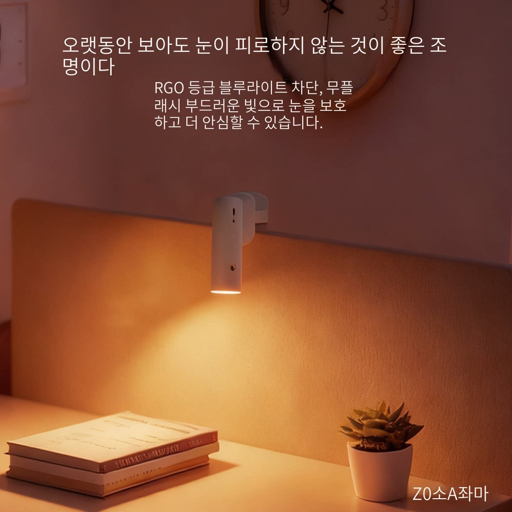
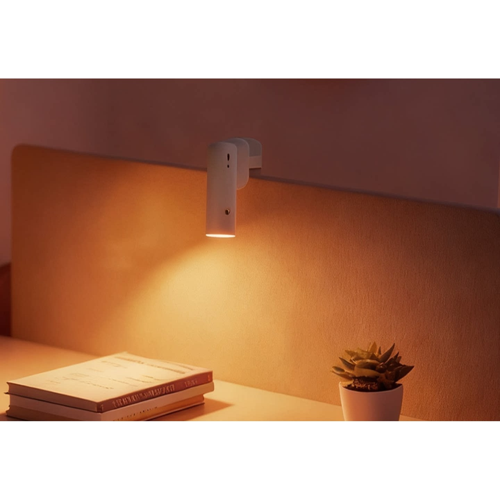

# H-rep2 crop prototype — NOT production acceptance

Status: draft, not wired into rep_auto_clean. No operation was queued and no image
was uploaded to a marketplace or Cloudinary. This is a local raster experiment.

## Before and after

Input: existing repository fixture `docs/screens/patrol148/before-d5af2185-p2.jpg`
at main `362f407391f470c525729da1f5bdbd57bdc74efb` (1440 × 1440).
This is the previously captured displayed image, not a newly fetched source photo.

Manually reviewed rectangles on this fixture (NOT Tencent OCR output):

- Text regions: [170,95,1260,365], [1150,1360,1390,1420].
- Protected lamp: [570,520,770,850].
- Crop: [0,369,1440,1356]; retained image: 1440 × 987.
- Canvas: 1440 × 1440, white padding top=226; source-to-output offset=[0,-143].
- Test compares every retained decoded pixel, including the protected lamp,
  against the lossless PNG render: equal. The JPEG here is a preview only.
- Lossless PNG SHA256: f334e716a9bb8f956187d2465f67e491bb5cc6877aceee3c55bff5a57b8891c6.
- Book-spine text remains. Fresh Tencent OCR was NOT run; zero-box acceptance is
  NOT claimed. Product protection annotations are manual and fixture-specific.

SPORTLINK fixture `before-a3a35e92-p4.jpg` has lettering over the merchandise
and on the watch face. Edge-only cropping is rejected in the new test. It must
not be labelled a safe crop merely because promotional lines are near an edge.

## Implemented and checked

`rep_clean_geometry` provides crop planning, a lossless worker-only crop renderer,
and a symmetric variance ratio check. Rejects missing product regions, invalid
coordinates, central text, protected-region overlap, small retained images,
unoriented EXIF, animation and unsupported color modes. Imports no image
libraries at module load. Requires new OCR coordinates after cropping.

16 standalone unittest cases passed (0 skipped), including the repository lamp
photo and exact pixel checks. Command:
`python -m unittest discover -s tests -p test_rep_clean_geometry.py -v`.

## Still required before merge

- Wire the renderer through render_worker, without importing cv2 into the app worker.
- Establish trustworthy product-protection regions tied to the exact selected
  image version; do not treat OCR-empty space as proof of product absence.
- Add inpaint candidate rendering and actual local variance sampling. The scalar
  variance check alone is not a measured smear detector.
- Preserve quota accounting, candidate fallback, existing outbound version,
  original images, non-Coupang payloads and edit-coordinate isolation.
- Fresh OCR must measure the rendered output, with failure preserving hold.
- Add integration tests and compare actual candidate outcomes before/after.
- Full suite and all five required CI gates, plus repository review checklist.
- Do not automatically regenerate existing production edits or refresh listings.

## Pixel quality follow-up (2026-10-30)

Added `measure_inpaint_quality`: same-frame RGB inputs, per-channel variance of each edited rectangle plus a 2–12px context rim, exact protection-pixel preservation, and no changes outside the declared edit bounds. Unknown protection, product overlap, changed coordinates or zero variance reject the candidate. Measuring only the unchanged exterior ring cannot detect a flattened rectangle, so this measurement includes the edited interior. This remains a numerical gate, not proof of OCR completion or semantic product safety.

Targeted unittest now **22 passed, 0 skipped**. Six new cases use controlled raster arrays (not live inpaint evidence). No automatic pipeline wiring, product detector, or Tencent call was added. `image_edit.plan` supplies OCR/prop boxes and a version, but no product-protection regions. Production integration and the original merge checklist remain incomplete.

## Verified candidate orchestration (2026-10-30)

`rep_clean_candidate.crop_candidate` binds reviewed protection data to the exact source bytes (SHA256) and selected version, sends crop rendering through render_worker with a 30s limit, and calls fresh OCR on the output bytes. Only a strictly integer zero accepts the candidate; missing/stale evidence, worker failure, OCR exceptions, unmeasured or positive counts hold. Source boxes must not be reused after crop. This function has no upload, DB or item-mutation side effects.

Targeted tests: **28 passed, 0 skipped** (six new contract-double cases). This is not live OCR proof. The caller supplying complete server-side product protection and the real OCR callback is still missing; `rep_auto_clean.clean` is not switched over. Do not interpret this entry point as production activation.

Parent head a93539ec passed all five required CI gates. This commit requires its own gates and remains draft until the original integration/real-image acceptance checklist is complete.
# 2026-10-30 automatic-path integration checkpoint

`rep_auto_clean.clean` now invokes crop first, guarded TELEA when edge geometry
is unsuitable, texture/product checks, fresh OCR, and verified PNG upload.
Failed candidates advance in measured-box order; same source/review is not
repeated. Both daily caps remain. Outbound original/translated selection is not
changed; only a separately stored Coupang representative is selected.

Targeted regression: **58 passed, 0 skipped, 20 subtests passed**. Tests include
the actual lossless renderer plus transport/storage doubles; they are not live
Tencent, Cloudinary, database or marketplace validation.

## Actual rejected inpaint evidence

Source: [existing lamp photo](../patrol148/before-d5af2185-p2.jpg).
JPEG preview of output from the actual TELEA renderer, captured before the rejection gate (measurements use the lossless PNG before this preview compression):

[Measured values](inpaint-measurements.json): top rectangle variance ratio
**21.4992**, bottom **5.5708** (limit <1.5). Protected lamp and outside-edit
changed pixels: **0**. Visible top and bottom smearing therefore **fails**;
this output is not accepted, uploaded, or marked OCR-zero. Coordinates are
hand-reviewed fixture coordinates, not live product detector results.

## Remaining release blockers

- Production has no producer of complete reviewed product rectangles bound to
  selected URL/version/work-bytes hash. Missing evidence holds before rendering.
  Do not deploy this cutover until the producer and its trust boundary are wired;
  otherwise all unreviewed representative candidates will hold.
- No Tencent/Cloudinary credentials or production read connection in this
  execution environment. Need isolated authorized validation credentials and
  read-only product source/box records for the two live products; never paste
  secrets into the vault or chat. No operational queue/market actions authorized.
- Full suite and five CI gates must be rechecked on the new head. Local Chromium
  installer returned a truncated archive, so local browser full-suite is not
  verified. Targeted tests above did run on the complete repository checkout.

The older checkpoints above are historical, not current release claims.
